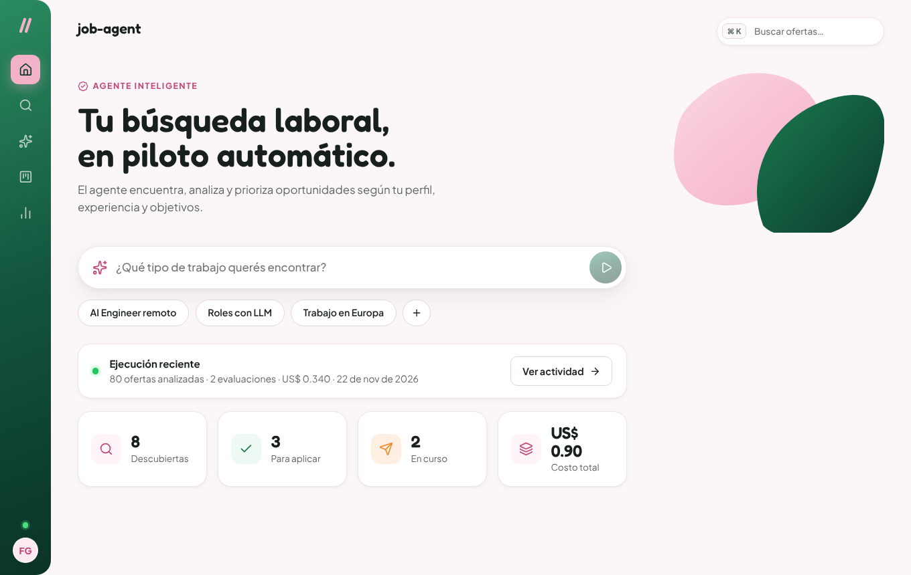
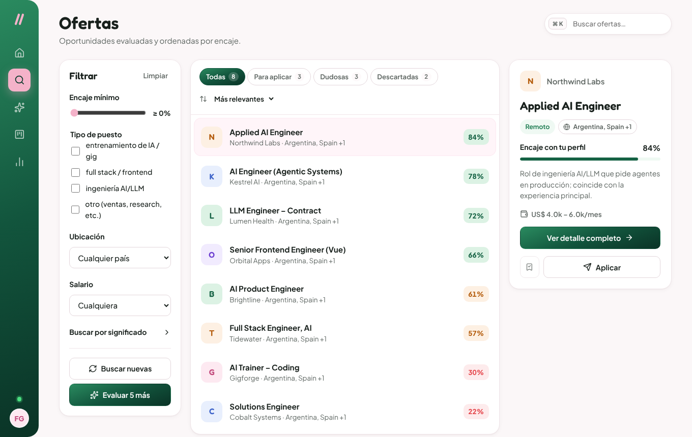
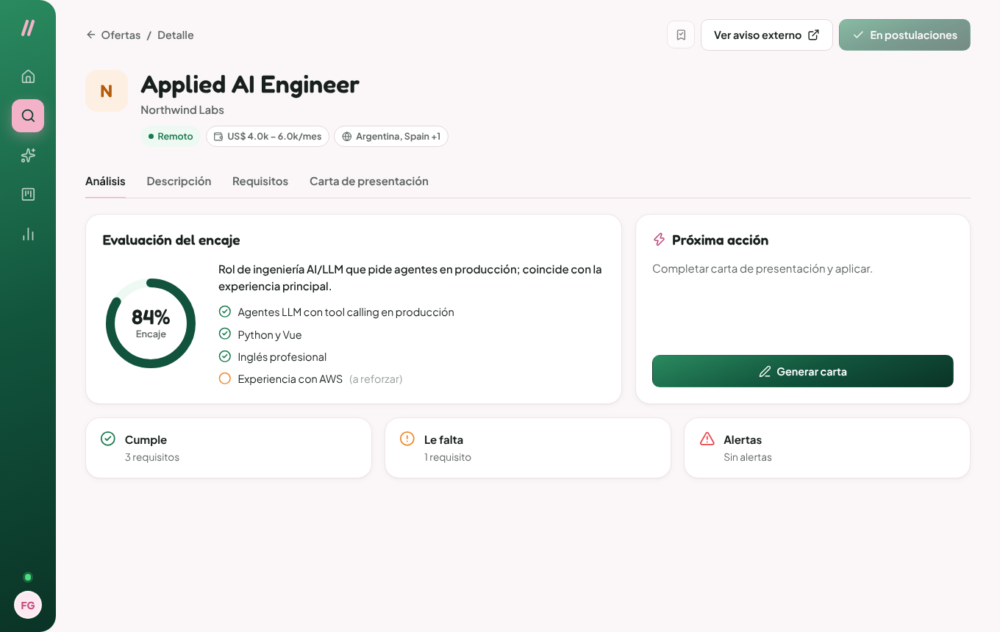
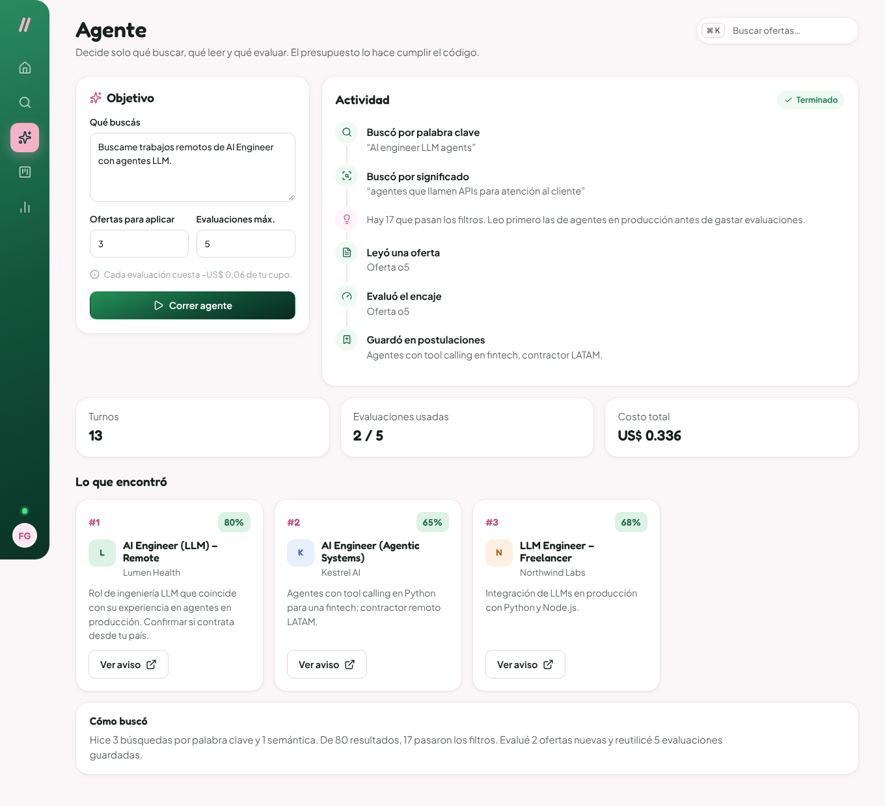
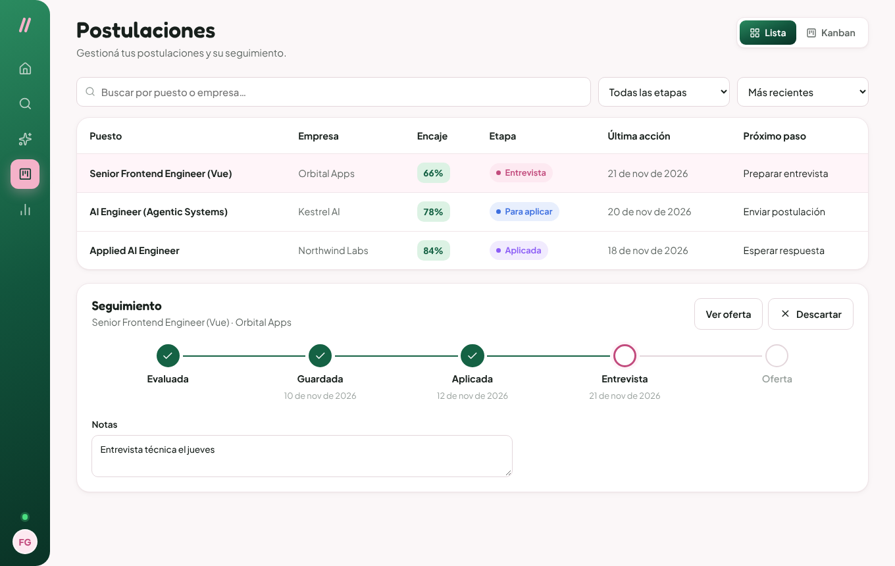

# job-agent

An AI agent that searches remote job postings, filters them against hard criteria in code, and uses Claude to judge how well each one fits a CV. It ships with a CLI, a FastAPI backend with live streaming, a Vue 3 UI, semantic search on pgvector, grounded cover-letter generation, and an eval harness that measures the agent against human labels.



> The UI and the code identifiers are in Spanish (the author's first language); this README is in English. Screenshots use fictional companies and sample data.

## What it does

| | |
|---|---|
| **Search** | Pulls postings from the [Himalayas](https://himalayas.app) public API (keyword search + general feed). |
| **Filter in code** | Salary floor (normalized to USD/month), timezone overlap with tolerance, allowed countries, seniority, expired or empty postings. Deterministic, tested, free. |
| **Judge with an LLM** | One Claude call per posting with structured output (JSON Schema from a pydantic model): fit score, verdict (`apply` / `maybe` / `discard`), what matches, what is missing, red flags. |
| **Agent** | Claude decides what to search, which postings to read and which to evaluate, using custom tools. The evaluation budget is enforced by the tools, not by the prompt. |
| **Semantic search** | Postings are embedded (model2vec) and stored in Postgres + pgvector with an HNSW index. Finds "build agents that call APIs for customer support" even when the posting uses different words. |
| **Cover letters (RAG)** | Generated only from a fact base of the candidate's experience. Every claim cites its source fragment; a code check and a second model verify groundedness before the letter is accepted. |
| **Evals** | Stratified sample, blind labeling screen (the model's verdict is never sent to the browser while you label), repeated runs streamed live. Reports exact agreement, severe errors, consistency and a confusion matrix. |
| **UI** | Offers with filters and preview, detail with analysis and letter, application tracker with stage history, live agent timeline (SSE), eval dashboard. |

## Architecture

```
               ┌───────────── Vue 3 + TS (web/) ─────────────┐
               │  Offers · Detail · Tracker · Agent · Evals  │
               └──────────────────────┬──────────────────────┘
                                      │ REST + Server-Sent Events
┌─────────── CLI ───────────┐  ┌──────┴──────── FastAPI (api.py) ─────────┐
│ buscar · evaluar · agente │  │ endpoints, SSE streams, serves web/dist  │
└─────────────┬─────────────┘  └──────┬───────────────────────────────────┘
              └──────────────┬────────┘
     ┌───────────────────────┼─────────────────────────────┐
     │                       │                             │
 filtros.py            agente.py (Claude Agent SDK)    carta.py (RAG)
 deterministic         tools: buscar_ofertas,          retrieve → draft with citations
 rules, unit tested    buscar_semantico, ver_oferta,   → citation check in code
     │                 evaluar_oferta, guardar_en_     → verifier model
     │                 tracker · budget · logging hook
     │                       │
 sources/himalayas.py   evaluador.py ── structured output (pydantic → JSON Schema)
                             │
                       vectores.py ── Postgres + pgvector (HNSW, cosine)
```

### Design decisions

- **Code for what is binary, the LLM for judgment.** Salary, timezone and country are filters with tests. The model only reads free text and decides fit. Cheaper, reproducible, and the LLM's job is narrow enough to evaluate.
- **Guardrails live in the tools.** The agent's prompt asks it to be frugal, but `evaluar_oferta` refuses once the budget is spent, and `guardar_en_tracker` only accepts postings with an `apply` verdict. Tools are the agent's security boundary.
- **Hard rules on top of the LLM.** If the model says *apply* but couldn't confirm the candidate can be hired from where she lives, the verdict is capped at *maybe* in code. The evals showed the model flagging that risk and recommending to apply anyway. Rules also run when loading old evaluations, so they apply retroactively at no cost.
- **Location coverage, not just a country match.** For someone who splits the year between places, a posting only qualifies if it accepts at least one country from *each* place (or worldwide). Postings covering only part of the year are filtered before the LLM (free) and can be shown with a toggle.
- **Right-sized models.** Evaluation (read and classify, run many times) uses Haiku; letters and the agent use Sonnet. Configurable per task with `JOB_AGENT_MODELO_*` env vars.
- **Don't pay twice for the same posting.** The same job published for several countries has different links; it's deduplicated by normalized company + title before evaluation. Expired postings are hidden.
- **Structured output, validated twice.** The same pydantic model generates the schema the SDK enforces and validates the response again on our side.
- **Grounded generation.** Cheap checks first (do the cited fragment ids exist?), then a second model with a different prompt and no incentive to "sound convincing". Max two attempts; otherwise the letter is flagged for human review.
- **Small knowledge base → no retrieval.** With ≤60 fragments, passing all of them beat top-k retrieval, which was dropping the strongest achievements because they shared fewer words with the posting.
- **Evals against a human, not an LLM judge.** "Should *I* apply?" is subjective, so the reference has to be the person. Severe errors (apply ↔ discard) are tracked separately from near misses.

The full log of what was built in each phase, why, and the bugs found along the way is in [`docs/APRENDIZAJE.md`](docs/APRENDIZAJE.md) (Spanish).

## Screenshots

| Offers | Detail |
|---|---|
|  |  |

| Agent (live) | Application tracker |
|---|---|
|  |  |

## Running it

Requirements: Python ≥ 3.11 with [uv](https://docs.astral.sh/uv/), Node ≥ 22.12, Docker (only for semantic search), and either a Claude subscription logged in through [Claude Code](https://docs.claude.com/en/docs/claude-code) or an `ANTHROPIC_API_KEY`.

```bash
uv sync
cd web && npm install && npm run build && cd ..
```

Personal data lives in `private/`, which is git-ignored. Create:

- `private/criterios.json` — search criteria:
  ```json
  {
    "nombre": "Your Name",
    "roles": ["AI Engineer", "LLM Engineer"],
    "zonaHoraria": { "minUTC": -3, "maxUTC": 2, "toleranciaHoras": 2 },
    "paisesResidencia": ["Argentina", "Spain"],
    "zonasResidencia": [["Argentina"], ["Spain"]],
    "incluirParciales": false,
    "excluirSeniority": ["Intern"],
    "salarioMinimoUSDMes": 2500,
    "situacion": "Free text the evaluator should know (residency, availability...)"
  }
  ```
- `private/cv-en.md` — the CV the evaluator compares against.
- `private/experiencia.md` — fact base for cover letters, one fact per bullet.

Then:

```bash
uv run job-agent buscar                  # search + filter → private/candidatas.json
uv run job-agent evaluar --limite 5      # LLM evaluation  → private/evaluadas.json
uv run job-agent agente "Remote AI Engineer roles with LLM agents" --objetivo 3 --max-evaluaciones 5
uv run job-agent api                     # API + UI on http://127.0.0.1:8000 (OpenAPI docs at /docs)
```

Semantic search:

```bash
docker compose up -d                     # Postgres + pgvector on localhost:5433
uv run job-agent rag indexar --feed 10
uv run job-agent rag buscar "agents that call APIs for customer support"
```

Evals, from the UI (**Quality → Label**) or the CLI:

```bash
uv run job-agent evals preparar --n 25   # stratified sample of already-evaluated postings
# label them blind in the UI (keys 1/2/3), or fill tu_veredicto in private/evals/etiquetas.csv
uv run job-agent evals correr --repeticiones 2   # or the "Run" button, with live progress
```

Tests: `uv run pytest` (the pgvector tests run when `DATABASE_URL_TEST` is set).

> The API has no authentication and every LLM endpoint spends quota. It binds to `127.0.0.1` on purpose; don't expose it without adding auth and rate limiting.

## Stack

Python · Claude Agent SDK · pydantic · FastAPI · httpx · Postgres + pgvector · model2vec · pytest · Vue 3 · TypeScript · Vite · Docker

## Status

- [x] Search, filters, LLM evaluation
- [x] Agent with custom tools, budget and logging
- [x] Semantic search (pgvector)
- [x] Cover letters with groundedness verification
- [x] API with streaming + Vue UI
- [ ] Eval results on a hand-labeled set (harness done, labeling in progress)
- [ ] Recall@k for the semantic search

## License

[MIT](LICENSE) © 2026 Florencia Gambero
